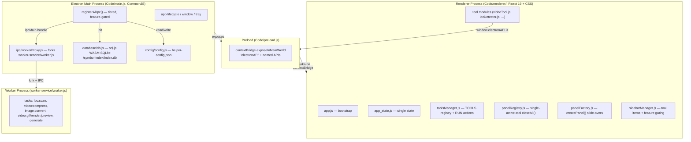

# 01 — HelperTool Codebase Architecture (Existing)

**Evidence status:** All items marked CONFIRMED are directly verified in source code at
commit `60c9531` (branch `main`). Items marked INFERRED/UNKNOWN/NOT PRESENT are noted
explicitly. This is a read-only reconnaissance document; no source code was modified.

---

## 1. Repository inventory

| Item | Path | Status | Notes |
|------|------|--------|-------|
| Project root | `C:\Users\Windows 10\Desktop\Personal\Tools\HelperTool` | CONFIRMED | Contains `Code/` (the actual Electron app), `docs/`, `plans/`, `MCP/`, `.Resources/`, `.Versions/`, `node_modules/`, root `package.json` (minimal) |
| App source tree | `Code/` | CONFIRMED | Contains `main.js`, `preload.js`, `package.json`, `renderer/`, `ipc/`, `database/`, `worker-service/`, `services/`, `utils/`, `config/`, `grammars/`, `indexer/`, `terminal/`, `tests/` |
| Root package.json | Root `package.json` | CONFIRMED | Only dependency: `yaml: ^2.9.1`. Not the Electron app manifest. |
| App package.json | `Code/package.json` | CONFIRMED | `name: helper-tool`, `version: 1.0.2`, `main: main.js`, `type: commonjs` |
| Main entry | `Code/main.js` | CONFIRMED | Electron main process (CommonJS) |
| Preload | `Code/preload.js` | CONFIRMED | 1036 lines, contextBridge |
| Renderer entry HTML | `Code/renderer/index.html` | CONFIRMED | Loads 18+ CSS files + `app.js` ES module |
| Renderer bootstrap | `Code/renderer/app.js` | CONFIRMED | ES module entry, wires all modules |
| IPC handlers | `Code/ipc/*.js` | CONFIRMED | ~50 modules incl. `workerProxy.js`, `video_ipc.js`, `image_ipc.js`, `loc_ipc.js`, `security_ipc.js`, `features_ipc.js` |
| Worker service | `Code/worker-service/worker.js` | CONFIRMED | Child-process task runner |
| Worker proxy | `Code/ipc/workerProxy.js` | CONFIRMED | Forks worker, manages request/response |
| Database (main app) | `Code/database/db.js` | CONFIRMED | sql.js (WASM SQLite) |
| Console DB | `Code/database/consoleDb.js` | CONFIRMED | `node:sqlite` (DatabaseSync) |
| Shared sql.js loader | `Code/database/sharedSqlJs.js` | CONFIRMED | Lazy `sql.js/dist/sql-wasm.js` |
| Config | `Code/config/config.js` | CONFIRMED | `helper-config.json` in userData |
| Logging | `Code/utils/log.js` | CONFIRMED | Console output filter installed at main start |
| File ops | `Code/utils/fileOps.js` | CONFIRMED | Folder tree walking, structure generation |
| FFmpeg utils | `Code/utils/ffmpeg.js`, `Code/utils/ffprobe.js` | CONFIRMED | Wrappers for ffmpeg-static / ffprobe-static |
| Tests | `Code/tests/*.test.mjs` | CONFIRMED | `node --test` runner |
| Build output | `Code/dist/` | CONFIRMED | `ES Code Setup 1.0.2.exe`, `win-unpacked/`, builder configs |

### Runtime versions (verified by `node -e`)

- **Electron:** 44.0.0 (devDependency `^44.0.0`; `ProjectOverview.md` says v39, which is OUTDATED — package.json/node_modules is authoritative)
- **Node.js:** v24.19.0
- **sql.js:** ^1.14.1
- **node-pty:** ^1.1.0
- **ffmpeg-static:** ^5.3.0


---

## 2. Main process (`Code/main.js`)

### 2.1 Application startup (CONFIRMED)

File: `Code/main.js`

- Line 1-10: Error handling — `process.on('uncaughtException')` and `process.on('unhandledRejection')` log to console.
- Line 2: `require('./utils/log').install()` installs a console filter that only allows `[Main]`, `[Tray]`, `[Docignore]`, `[DocIgnore]` log prefixes and blocks `[ErrorCop] processOutput failed`.
- Line 15: `app.setName('ES Code')`.
- Line 16: `app.setPath('userData', path.join(app.getPath('appData'), 'helper-tool'))` → user data at `%APPDATA%\helper-tool`.
- Line 69-75: Chromium command-line switches set **before** `app.whenReady()`: `disable-gpu-sandbox`, `num-raster-threads=1`, `disable-background-timer-throttling`, `disable-backgrounding-occluded-windows`, `disable-renderer-backgrounding`, `disable-features TranslateUI,AutofillServerCommunication`, `enable-features SharedArrayBuffer`.
- Line 85-96: Single-instance lock via `app.requestSingleInstanceLock()`; `second-instance` event restores/focuses existing window; `window-all-closed` is prevented (tray app, window hides instead of quitting).
- Line 102: `app.whenReady()` — the main async startup block.

### 2.2 User data paths (CONFIRMED)

- `app.getPath('userData')` = `%APPDATA%\helper-tool` (set at line 16).
- Main app SQLite DB: `<userData>/symbol-index/index.db` (Code/main.js:106, Code/database/db.js:6-7).
- Config file: `<userData>/helper-config.json` (Code/config/config.js:5-6).
- Base storage path (config default): `<userData>/HelperToolStorage` (Code/config/config.js:19).
- Console/repo-console DB: `<userData>/repo-console/console.db` (Code/database/consoleDb.js:127).
- Security reports store: `<userData>/repo-console` (Code/ipc/security_ipc.js:88).

### 2.3 Window creation (CONFIRMED)

File: `Code/main.js`, `createWindow()` at line 373.

```js
mainWindow = new BrowserWindow({
  width: 1200,
  height: 800,
  show: false,
  frame: false,                      // frameless / custom title bar
  maximizable: true,
  minimizable: true,
  backgroundThrottling: true,
  webPreferences: {
    preload: path.join(__dirname, 'preload.js'),
    nodeIntegration: false,          // CONFIRMED: disabled
    contextIsolation: true,          // CONFIRMED: enabled
    spellcheck: false,
    enableWebSQL: false,
    webviewTag: true,
    devTools: process.env.NODE_ENV !== 'production',
  }
});
```

- `mainWindow.loadFile(path.join(__dirname, 'renderer', 'index.html'))` (line 407).
- Window close is intercepted (line 436-440): `e.preventDefault(); mainWindow.hide();` — app runs to tray, never quits on close.
- `fitToWorkArea(mainWindow)` sizes to display workArea (line 368-371, 432).
- `mainWindow.webContents.on('will-attach-webview', ...)` (line 396) sandboxes embedded webviews: deletes preload, disables nodeIntegration, enables contextIsolation + sandbox, only allows http(s) sources.
- Tray (`createTray()`, line 472): `new Tray(path.join(__dirname, 'assets', 'es-code.png'))`; menu items: Open Helper, Select Previous Repo, Exit.

### 2.4 Application lifecycle & shutdown (CONFIRMED)

- `app.on('activate', ...)` (line 207): recreate window if none.
- `app.on('before-quit', ...)` (line 217): `config.flushConfig()` then `cleanupAndExit(false)`.
- `cleanupAndExit(deleteIndex)` (line 553): stops repo console jobs, optionally deletes `repositories` table + restore flags, closes DBs (`db.close()`, `closeChatDb()`), destroys watchers, stops prefetch, `workerProxy.stop()`, `indexerProxy.stop()`, `graphifyIpc.shutdown()`, researcher cleanup.
- Tray "Exit" (line 490-512): checks for running Repo Console job via `repoConsole_ipc.hasRunning()`, prompts user, then `tray.destroy(); cleanupAndExit(true); app.exit(0);`.

### 2.5 IPC registration pattern (CONFIRMED)

File: `Code/main.js`, `registerAllIpc(onRepoSelected, syncIndexer)` at line 227.

- A `shared` object is passed to each IPC module: `{ app, config, fileOps, docignoreUtils, codeOps, getMainWindow, onRepoSelected }` (line 228).
- `safeRegister(name, fn)` (line 235): wraps module registration in try/catch, logs failures without aborting startup.
- IPC modules are registered in **tiers** to free the event loop for first paint:
  - **Tier 0 (eager, before first paint):** `harness_ipc`, `terminal_ipc`, `serviceTracker_ipc`, `opencode_ipc` (lines 313-316).
  - **Tier 1 (100ms):** `repo_ipc`, `features_ipc`, `secrets_ipc`, `watcher_ipc`, `git_ipc`, `generate_ipc`, `codebaseManager_ipc`, `prompts_ipc`, `shortcut_ipc`, plus feature-gated tier-1 modules (lines 319-333).
  - **Tier 1b (600ms):** `error_cop_ipc` (line 336-338).
  - **Tier 2 (after 4s + boot):** heavy/rarely used tools, one per tick via `startupQueue.whenBooted()` + `runSpread(steps, 25)` (lines 341-348).
- `FEATURE_IPC` array (lines 259-284): each entry `{ name, tier, flags, load }`. Feature-gated via `featureOn(feats, flags)` — null features (first launch) means everything is on.
- `ipcMain.handle` wrapper instrumentation (lines 18-32): wraps every `ipcMain.handle` to log IPC calls taking >10ms as `[Perf] IPC <channel>: <duration>ms`.
- Window control via `ipcMain.on` (fire-and-forget): `window:minimize`, `window:maximize`, `window:close` (lines 351-356). `shell:openExternal` handle (line 358) only allows http(s) URLs.

### 2.6 Service / worker lifecycle (CONFIRMED)

- `workerProxy.start()` (line 158): forks the worker process (non-blocking).
- `initDatabase(app)`, `initChatDb(app)`, `initErrorCopDb(app)` (lines 151-155): run in parallel via `Promise.all` before window creation, yielding between them.
- `prefetchService.registerIpc()` + deferred start (lines 133-136).

---

## 3. Preload & IPC architecture (`Code/preload.js`)

### 3.1 Security settings (CONFIRMED)

- `contextIsolation: true` (main.js:386) — the preload bridge is isolated from the renderer's JS context.
- `nodeIntegration: false` (main.js:385) — renderer has no direct Node.js access.
- No `sandbox` flag on the main window (webview guests are sandboxed, main window is NOT).
- `devTools` disabled in production (main.js:390).

### 3.2 Bridge pattern (CONFIRMED)

File: `Code/preload.js` (1036 lines).

- Every capability is exposed via `contextBridge.exposeInMainWorld('<name>', <object>)`.
- The principal bridge is `window.electronAPI` (line 789), a spread of per-domain bridge objects including `repoBridge`, `generateBridge`, `featuresBridge`, `secretsBridge`, `apitoolBridge`, `workspaceBridge`, `gitBridge`, `promptsBridge`, `symbolIndexBridge`, `canvasBridge`, `fileseederBridge`, `locBridge`, `dbInspectorBridge`, `portManagerBridge`, `terminalBridge`, `errorCopBridge`, `watcherBridge`, `teamActivityBridge`, `blueprintBridge`, `profileBridge`, `branchBridge`, `codebaseChatBridge`, `codebaseMapBridge`, `graphifyBridge`, `automationBridge`, `shortcutBridge`, `harnessBridge`, `watcher`, `eco`, `codebaseManagerBridge`, `imageBridge`, `videoBridge`, `gmailBridge`, `githubBridge`, `opencode`, `gemini`, `windowControls`, `openExternal`.
- Additional standalone exposed APIs include `openWithAPI`, `projectInspector`, `dockerAPI`, `serviceTrackerAPI`, `repoConsoleAPI`, `ideAPI`, `ideSearchAPI`, `versionsAPI`, `deployAPI`, `storageInspectorAPI`, `repoDetailsAPI`, and many others.

### 3.3 IPC call style (CONFIRMED)

- **Request/response:** `ipcRenderer.invoke('channel-name', arg1, arg2, ...)` returns a Promise.
- **Events (progress/streaming):** `ipcRenderer.removeAllListeners('channel:event')` then `ipcRenderer.on('channel:event', (_, data) => callback(data))`. Used by `symbolIndex:onProgress`, `video:onProgress`, `video:onGifProgress`, `video:onRenderProgress`, `image:onConvertProgress`, `errorCop:onNewError`, `gmail:onPollResult`, `opencode:onStream`, `harness:onHarnessEvent`, `serviceTracker:onUpdate`, `repoConsole:onEvent`, `ide:searchBatch`, `deploy:viewState`.
- **Fire-and-forget:** `ipcRenderer.send('window:minimize')` etc. (windowControls).

### 3.4 Representative bridge methods (CONFIRMED)

`videoBridge` (lines 533-560) exposes `video: { pickFile, pickOutputFolder, getMetadata, compress, revealFile, onProgress, onGifProgress, onRenderProgress, onPreviewProgress, gif, render, preview }`, each mapping to `ipcRenderer.invoke('video:<op>', payload)`.

`imageBridge` (lines 519-531) exposes `image: { pickFiles, pickOutputFolder, getMetadata, convert, revealFile, onConvertProgress }`.


### 3.5 IPC channel naming conventions (CONFIRMED + INFERRED)

Channels observed (non-exhaustive):
- `select-repo`, `select-folder`, `getFolderTree`, `read-file`, `write-file`, `save-file-dialog`, `get-user-data-path`
- `features-get`, `features-set`
- `apiToolGetAll`, `apiToolSaveAll`
- `workspaceGetAll`, `workspaceSaveAll`
- `git:status`, `git:stage`, `git:commit`, `git:push`, `git:diff`, `git:log`, ...
- `prompts-load`, `prompts-upsertPrompt`, ...
- `symbolIndex:init`, `symbolIndex:search`, `symbolIndex:progress`, `symbolIndex:error`
- `canvas:listBoards`, `canvas:createBoard`, ...
- `fileseeder:preview`, `fileseeder:seed`, ...
- `loc:scan`, `loc:openFile`
- `dbInspector:testConnection`, `dbInspector:scan`, `dbInspector:executeQuery`, `dbInspector:exportPdf`
- `port-manager:list`, `port-manager:kill`
- `terminal:spawn`, `terminal:write`, `terminal:kill`, `terminal:data`, `terminal:exit`, `terminal:ready`
- `error-cop:getErrors`, `error-cop:new-error`, `error-cop:startServer`, `error-cop:stopServer`
- `video:pickFile`, `video:compress`, `video:progress`, `video:render`, `video:renderProgress`, `video:gif`, `video:gifProgress`, `video:preview`, `video:previewProgress`, `video:getMetadata`, `video:revealFile`
- `image:pickFiles`, `image:convert`, `image:convertProgress`, `image:getMetadata`, `image:revealFile`
- `shell:openExternal`
- `security:detect`, `security:run`, `security:getSettings`, `security:setSettings`
- `serviceTracker:getAll`, `serviceTracker:update`
- `repoConsole:run`, `repoConsole:event`, `repoConsole:job`
- `watcher:query`, `watcher:runCommand`, ...
- `graphify:start`, `graphify:stop`, `graphify:status`
- `deploy:load`, `deploy:search`, `deploy:saveAccount`, ...
- `storageInspector:catalog`, `storageInspector:dbTables`, `storageInspector:readFile`, `storageInspector:listDir`

### 3.6 IPC response envelope conventions (INFERRED)

- Most `ipcMain.handle` handlers return `{ success: true, ...result }` or `{ success: false, error: err.message }` (observed in `loc_ipc.js`, `image_ipc.js`, `video_ipc.js`).
- `security_ipc.js` uses a distinct envelope: `{ ok: true, ...out }` or `{ ok: false, error, status }` via a `handle()` wrapper (lines 103-112).
- No centralized response schema; each IPC module defines its own shape. **REQUIRES DECISION:** Document Studio should pick one envelope and document it.

### 3.7 Sender validation & authorization (CONFIRMED / NOT PRESENT)

- `ipcMain.handle` handlers receive `event` (IpcMainInvokeEvent) but most existing handlers do **not** validate `event.sender` (webContents) — sender validation is largely NOT PRESENT in existing IPC modules.
- `security_ipc.js` `knownRepo(repoPath)` checks the repo is registered in config and exists on disk (lines 90-101) — a form of authorization, repo-scoped.
- No centralized IPC authorization middleware is present. **NOT PRESENT:** Document Studio must add its own request validation.


---

## 4. Renderer & tool registration architecture

### 4.1 Layout (CONFIRMED)

File: `Code/renderer/index.html`

- Custom frameless title bar (`#appTitlebar`) with min/max/close buttons.
- Navbar row 1: search, shortcut mode, global seeder, generate mode, view mode, right-side buttons (Gmail, Automation, Essentials, Notes, Refresh, Docignore).
- `app-body` contains:
  - `#toolsSidebar` — collapsible tools sidebar (`tools-sidebar pinned expanded`), `#toolsSidebarBody` is populated by `toolsManager.populateSidebar()`.
  - `#appMain` — root jumper, select-shortcut bar, status/filter bar with progress bar (`#progressBar`, `#progressText`), filter/ignore/folder panels, tree container (`#treeContainer`).
- Progress indicator: native `<progress id="progressBar" value="0" max="100">` + `#progressText` (index.html:277-280).

### 4.2 State management (CONFIRMED)

File: `Code/renderer/app_manager/appState.js`

- Single exported `state` object (lines 9-19): `selectedRepoPath`, `selectedItems`, `cachedTree`, `actionType`, `generateMinified`, `generateOutputType`, `viewMode`, `selectedPromptText`, `selectedPromptId`, `selectedPromptIds`.
- `viewMode` initialized from `localStorage.getItem('helpertool-viewmode')` or `DEFAULT_PREFERENCES.app.viewMode` (defaultPreferences.js:108).

### 4.3 Tool registration (CONFIRMED)

File: `Code/renderer/app_manager/toolsManager.js`

- `ICONS` object (lines 37-71): inline SVG strings keyed by tool id.
- `TOOLS` array (lines 736-774): each entry `{ id, key, flag, icon, name, desc, shortcut }`. This **is the tool registry**. Example entries:
  - `{ id: 'video', key: 'video', flag: 'videoTool', icon: '🎬', name: 'Video Compressor', desc: 'Compress video files with FFmpeg', shortcut: 'videoTool' }` (line 741)
  - `{ id: 'loc', key: 'loc', flag: 'locDetector', icon: ICONS.loc, name: 'LOC Detector', desc: 'Find bloated files by line count', shortcut: 'locDetector' }` (line 745)
- `RUN` object (lines 457-733): maps `key` → async action function. Each action typically: toggle if already open, `_registry.closeAll()` (single-active-tool rule), lazily init panel + tool, show panel.
- `on(flag)` helper (line 138): `!flag || _feats[flag] !== false` — null features means enabled.
- `populateSidebar()` (lines 790-803): iterates `TOOLS`, skips disabled (`!on(t.flag)`), creates sidebar item via `createSidebarItem(icon, name, desc, () => _run(t.key, item), t.id)`.
- `initTools(feats, settingsManager)` (lines 894-999): sets feature flags, inits fileSeeder/sessionNotes/diffViewer/fileViewer, `initSidebar()`, `requestAnimationFrame(() => populateSidebar())`, context menu wiring, shortcut manager, MCP tool registration, `_lazyInitTools(feats)` (apiTool, secretHolder, workspaceTool, canvasTool, dbInspector, portManagerTool, dockerTool), sets `_toolsReady = true`.
- `handleRepoChange(newRepoPath)` (lines 847-880): tears down graphify/git/symbolIndex/codebaseChat tools on repo switch, starts prefetch, updates project inspector.
- `closeAllPanels()` (line 838): `_registry.closeAll()` + close diffViewer/fileViewer/gmail/automation/github.
- `_run(key, item)` (lines 776-786): dispatches to `RUN[key]`.


### 4.4 Panel system (CONFIRMED)

File: `Code/renderer/app_manager/panels/panelRegistry.js`

- `PanelRegistry` class: tracks open panels in a `Map`, provides `closeAll()` implementing the **single-active-tool rule** (closes every other tool/panel when one opens).
- `register(name, panel)`: `this._panels.set(name, panel)`.
- `closeAll()`: closes apiTool, secretHolder, sessionNotes, workspace, canvas, dbInspector, portManager panels; removes modal overlays (env, prompt, cm, settings, cli); removes all registered panels' `open` class; closes fileSeeder, locDetector, codebaseMap, diffViewer, fileViewer, teamActivity, blueprintLibrary, profile, essentials, docker, terminal, codeSwamp, UI Layout Helper, graphify, errorCop, MCP, researcher, ecosystemDashboard, harness, performanceTracker, serviceTracker.

File: `Code/renderer/app_manager/panels/panelFactory.js`

- `createPanel({ id, className, title, containerId, closeBtnId, closeIcon, closeLabel })`: creates a slide-over panel `div`, appends to `document.body`, wires close button + click-outside + Escape key, returns `{ panel, container }`.
- `createVideoPanel()` → `{ id: 'videoToolPanel', className: 'vt-panel', title: '🎬 Video Compressor', containerId: 'videoToolContainer', closeBtnId: 'closeVideoToolBtn' }` (lines 93-101).
- `createLocPanel()` → `{ id: 'locDetectorPanel', className: 'loc-detector-panel', ... }` (lines 83-91).
- Other panels: git, symbolIndex, deps, gmail, automation, codebaseChat, github, opencode, mcp, projectInspector, graphify.

File: `Code/renderer/app_manager/sidebarManager.js`

- `TOOL_FEATURE` map (lines 9-45): sidebar tool key → feature flag id (e.g. `video: 'videoTool'`, `loc: 'locDetector'`).
- `isToolEnabled(toolKey)`: reads `getFeatures()[featureId] !== false`.
- `createSidebarItem(icon, name, desc, onClick, toolKey)`: creates `.tools-sidebar-item` button, hides if not enabled.
- `initSidebar()`: expand/collapse/pin behavior.

### 4.5 Feature flags (CONFIRMED)

File: `Code/ipc/features_ipc.js`

- `ipcMain.handle('features-get', ...)`: returns `cfg.features ?? null` (null = first launch, all on).
- `ipcMain.handle('features-set', ...)`: merges with `DEFAULT_FEATURES`, writes config, calls `onFeaturesChanged`.
- `DEFAULT_FEATURES` (lines 3-9): `apiTool, secretHolder, themeEngine, folderFilters, swagger` default true.
- Full feature defaults in `Code/config/config.js:22-62` (e.g. `videoTool: true`, `locDetector: false`, `dbInspector: true`, `projectInspector: true`).
- Preload `featuresBridge` (preload.js:60-63): `featuresGet()`, `featuresSet(f)` → `features-get` / `features-set`.

### 4.6 Navigation / modals / notifications (CONFIRMED / INFERRED)

- Single-active-tool rule via `PanelRegistry.closeAll()` (CONFIRMED).
- Panels are slide-over DOM elements appended to `document.body` (CONFIRMED, panelFactory).
- Modals: `shortcutInputModal`, `shortcutResultsModal`, `promptToolModal`, `envOverlay`, `settingsOverlay`, `lightSettingsOverlay` (index.html).
- `showToast(...)` imported from `codebaseManager.js` in toolsManager (used for delete confirmation).
- Confirm dialog: `utils/confirmDialog.js` (`openRenameModal`, `openInputContentModal`, etc. in `codebaseManager.js`).
- Progress bar: native `<progress>` in index.html status bar; driven by IPC progress events.


---

## 5. Worker architecture (`Code/worker-service/`)

### 5.1 Worker entry (`Code/worker-service/worker.js`) (CONFIRMED)

- `lazy(mod)` helper (lines 1-7): lazy `require()` on first use.
- `tasks` map (lines 10-21): simple (non-progress) tasks — `loc:scan`, `gitGraph`, `profileData`, `teamActivity`, `portManager`, `gitBranches`, `gitOperations`, `walkDir`, `folderTree`, `profileSync`.
- `multiTypeTasks` (lines 23-25): `db` → `./tasks/dbInspector` (handles `db:testConnection`, `db:scan`, `db:executeQuery`).
- `progressTasks` (lines 27-34): tasks taking `(payload, onProgress)` — `generate`, `video:compress`, `image:convert`, `video:gif`, `video:render`, `video:preview`.
- Line 36: `process.send({ id: 'bootstrap', type: 'ready' })` — signals readiness to parent.
- Line 38-71: `process.on('message', ...)`:
  - Message shape: `{ id, type, payload }`.
  - `onProgress(data)` (lines 41-46): sends `{ id, type: 'progress', data: progressData }` back to parent; wraps non-object data as `{ percent: data }`.
  - Dispatches to `simpleTask(payload)`, `multiTypeTasks.db(type, payload)`, or `progressTask(payload, onProgress)`.
  - On success: `process.send({ id, type: 'result', data: result })` (line 65).
  - On error: logs `[Worker] Task error`, sends `{ id, type: 'error', message }` (lines 66-69).
  - Unknown task type throws `Error('Unknown task type: ' + type)`.
- Line 73-75: `process.on('disconnect', () => process.exit(0))`.

### 5.2 Worker proxy (`Code/ipc/workerProxy.js`) (CONFIRMED)

- `fork(_getWorkerPath(), [], { silent: false })` (line 55): child process path = `Code/worker-service/worker.js`.
- `_pending` Map (line 7): `id` → `{ resolve, reject }`; `_requestId` counter (line 8).
- `_sendRaw(msg, timeout)` (lines 108-126): assigns `id = ++_requestId`, default timeout `120000` ms (line 112), sends `{ id, type, payload }` to child, rejects on timeout with `Worker request timed out: <type>`.
- `send(type, payload, timeout)` (lines 186-190): spawns worker if not running, queues or sends.
- `onProgress(cb)` / `offProgress(cb)` (lines 192-198): EventEmitter `_events`; worker progress messages emitted to registered callbacks.
- `start()` / `stop()` / `sleep(force)` / `wake()` / `isAsleep()` / `isReady()` / `isBusy()`.
- `_scheduleRestart()` (lines 135-142): exponential backoff `_restartDelay` capped at 30000ms; only restarts if not idle/stopped.
- `child.on('exit')` (lines 83-91): `_rejectAll(new Error('Worker process exited'))`, schedules restart.
- `updateService('worker', ...)` calls `serviceTracker_ipc` for UI service status.

### 5.3 How an IPC handler uses the worker (CONFIRMED — example `image_ipc.js:54-69`)

```js
ipcMain.handle('image:convert', async (event, payload) => {
  const win = getMainWindow();
  try {
    const progressHandler = (progress) => {
      if (win && !win.isDestroyed()) {
        win.webContents.send('image:convertProgress', progress);
      }
    };
    workerProxy.onProgress(progressHandler);                    // register global progress listener
    const result = await workerProxy.send('image:convert', payload);  // send task
    workerProxy.offProgress(progressHandler);                   // unregister
    return { success: true, ...result };
  } catch (err) {
    return { success: false, error: err.message };
  }
});
```

Note: `workerProxy.onProgress` is a **global** listener, not request-scoped — concurrent progress tasks would interfere (INFERRED limitation).


---

## 6. Database & persistence

### 6.1 Main app database — sql.js (WASM) (CONFIRMED)

File: `Code/database/db.js`

- Library: `sql.js` (WASM, no native dependencies), loaded via `sharedSqlJs.js` (`require('sql.js/dist/sql-wasm.js')`).
- Path: `<userData>/symbol-index/index.db` (`getDbPath()`, lines 30-34).
- Journal mode: WAL (`PRAGMA journal_mode=WAL`, line 54); foreign keys ON (line 55).
- `_db` is a Proxy wrapping `SQL.Database` (lines 59-74): tracks `_dirty` flag on `run`/`exec`/`prepare`, optional debug query logging.
- `initDatabase(app)` (lines 36-82): yields (`setTimeout(r, 0)`) before sync I/O and before schema creation so renderer first paint isn't blocked; calls `createSchema()` then `_flush()`.
- `createSchema()` (lines 91-321): creates tables `repositories`, `indexed_files`, `symbols`, `symbols_fts` (FTS5 with triggers), `file_imports`, `boards`, `blueprint_categories`, `blueprints`, `kit_items`, `profile`, `profile_meta`, `activity_days`, `file_save_events`, `github_repo_trees`. Conditional on `process.env.SKIP_SHARED_DB` for shared tables.
- Debounced save: `save()` sets a 5000ms timer → `_flush()` (lines 378-385); `saveImmediate()` flushes now; `_flush()` exports DB to buffer and writes via a `worker_threads` Worker (`WRITE_WORKER_CODE`, lines 9-20) for async file write.
- `close()` (lines 394-407): flush sync, terminate write worker, `_db.close()`.
- Exports: `initDatabase, getDb, save, saveImmediate, close, getDbPath`.

### 6.2 Console DB — `node:sqlite` (CONFIRMED)

File: `Code/database/consoleDb.js`

- Library: `node:sqlite` `DatabaseSync` (built-in, Node 22+).
- Path: `<userData>/repo-console/console.db`.
- Schema versioning via `PRAGMA user_version` (V1: `runs`, `run_steps`, `run_logs`; V2: `run_errors` + columns; V3: `security_profiles`, `security_settings`).
- `tx(fn)` helper: `BEGIN`/`COMMIT`/`ROLLBACK`.
- Functions: `init(app)`, `close()`, `startRun(view, meta)`, `appendLogs(runId, entries)`, `finishRun(view)`, `markInterrupted()`, `insertErrors(runId, errors)`, `listRuns(repoPath, opts)`, `getRun(runId)`, `pruneRuns(repoPath, keep, kind)`, `clearRuns(repoPath)`, `saveSecurityProfile`, `getSecurityProfile`, `saveSecuritySettings`, `getSecuritySettings`.
- `redact(text)` (lines 100-105): redacts passwords/tokens/Bearer URLs in stored text.
- `snapshotJson` caps snapshots at 200000 chars.

### 6.3 Other DB modules (CONFIRMED)

- `database/chatDb.js` — `initChatDb`, `closeChatDb` (referenced in main.js:47).
- `database/errorCopDb.js` — `initErrorCopDb` (referenced in main.js:48).
- `database/changeDetector.js`, `codebaseFlow.js`, `codebaseMap.js`, `githubTrees.js`, `imports.js`, `indexedFiles.js`, `repositories.js`, `symbols.js`, `symbolsJsonLoader.js`, `dualWrite.js`.

### 6.4 Multiple-process DB access (NOT PRESENT)

- Main DB (sql.js) is only accessed from the main process. Console DB (`node:sqlite` DatabaseSync) is main-process only. No IPC exposes raw SQL to the renderer. **NOT PRESENT:** no multi-process DB sharing.

### 6.5 File management & document storage

#### Native dialogs (CONFIRMED)

- `dialog.showOpenDialog(win, { title, filters, properties: ['openFile', 'multiSelections', 'openDirectory'] })` — used in `image_ipc.js` (pickFiles, pickOutputFolder) and `video_ipc.js` (pickFile, pickOutputFolder).
- `shell.showItemInFolder(filePath)` — `revealFile` handlers.
- `shell.openPath(filePath)` — `loc:openFile`.
- `shell.openExternal(url)` — only http(s), via `shell:openExternal` IPC (main.js:358).

#### File validation (CONFIRMED / PARTIAL)

- `image_ipc.js:4-6`: `IMAGE_FILTERS = [{ name: 'Images', extensions: ['png','jpg','jpeg','webp','gif','avif','tiff','svg'] }]` (dialog filter only, no server-side re-validation seen).
- `video_ipc.js:9-12`: video extensions filter `['mp4','mov','avi','mkv','webm','wmv','m4v']`.
- `loc_ipc.js:8-9`: `if (!rootPath || !fs.existsSync(rootPath)) return { success: false, error: 'Invalid directory path.' }`.
- No central file-validation helper, no size limits, no malware scanning, no symlink/path-traversal protection observed. **NOT PRESENT:** centralized file validation.

#### Temp/output directories (NOT PRESENT / PARTIAL)

- `config.ensureStorageFolder(storagePath)` (config.js:163-172): creates `<storagePath>/Codes` and `<storagePath>/Structures`.
- `baseStoragePath` default: `<userData>/HelperToolStorage` (config.js:19).
- No dedicated temp directory convention observed for large processing jobs. **NOT PRESENT.**

#### Application user-data directory (CONFIRMED)

- `%APPDATA%\helper-tool` (main.js:16).
- Sub-directories actually used: `symbol-index/`, `repo-console/`, plus config file `helper-config.json`.


---

## 7. Build, packaging & distribution

### 7.1 electron-builder config (`Code/package.json`, lines 18-54) (CONFIRMED)

- `appId`: `com.eric.helpertool`
- `productName`: `ES Code`
- `icon`: `assets/es-code.ico` (mac/general), `assets/icon.ico` (win)
- `directories.output`: `dist`
- `files`: `**/*` (everything)
- `asarUnpack` (lines 28-35): `grammars/**`, `node_modules/node-pty/**`, `node_modules/web-tree-sitter/**`, `node_modules/sql.js/**`, `node_modules/tree-sitter-*/**`, `node_modules/@ffprobe-installer/**` — these are unpacked from ASAR because they need native/WASM side-loading or dynamic require paths.
- `extraResources` (lines 36-44): `from: ../.Resources/Rules` → `to: .Resources/Rules`.
- `win.target`: `nsis`; `nsis.oneClick: false`; `nsis.allowToChangeInstallationDirectory: true`.
- `npmRebuild: false`.

### 7.2 Build scripts (`Code/package.json`, lines 8-17) (CONFIRMED)

- `start`: `electron .`
- `test`: `node --test tests/*.test.mjs`
- `build`: `electron-builder`
- `build:win`: `electron-builder --win`
- `build:dbgraph`: `esbuild renderer/databaseInspector/graph.jsx --bundle --outfile=renderer/databaseInspector/graph-bundle.js --format=esm`
- `build:codebasegraph`: `esbuild renderer/codebaseMap/codebaseMapGraph.jsx --bundle --outfile=renderer/codebaseMap/codebaseMap-graph-bundle.js --format=esm`
- `build:css`: `node scripts/build-css.mjs`
- `postinstall`: `node scripts/build-css.mjs`

### 7.3 DevDependencies (Code/package.json:55-60)

- `electron: ^44.0.0`, `electron-builder: ^26.8.1`, `esbuild: ^0.28.0`, `tree-sitter-cli: ^0.26.13`.

### 7.4 Runtime dependencies relevant to Document Studio (Code/package.json:61-90)

- `sharp: ^0.35.1` (image metadata/processing, used by image_ipc)
- `ffmpeg-static: ^5.3.0` + `@ffprobe-installer/ffprobe: ^2.1.2` (video)
- `sql.js: ^1.14.1` (main DB)
- `node-pty: ^1.1.0` (terminal)
- `react: ^19.2.7`, `react-dom: ^19.2.7`, `reactflow: ^11.11.4` (UI)
- `simple-git: ^3.36.0`, `chokidar: ^5.0.0`, `micromatch: ^4.0.8`, `minimatch: ^10.1.1`
- **No Python, no PDF, no DOCX, no OCR libraries present.** **NOT PRESENT.**

### 7.5 Packaging implications for a Python sidecar (INFERRED / REQUIRES DECISION)

- `asarUnpack` exists as a mechanism to expose native/WASM modules outside the ASAR archive. A Python sidecar executable would likely need `asarUnpack` (or `extraResources`) and to be referenced by an absolute path from `process.resourcesPath` or `__dirname`.
- `extraResources` already used for `.Resources/Rules` — a model for bundling a Python runtime or PyInstaller bundle alongside the app.
- `npmRebuild: false` — native modules are prebuilt; a Python sidecar would avoid native Node rebuild concerns.
- Built artifact: `ES Code Setup 1.0.2.exe` (NSIS installer, oneClick=false, allows changing install dir).
- Antivirus false positives on bundled Python/PyInstaller executables: UNKNOWN (not tested, no evidence in repo).


---

## 8. Testing & development workflow

### 8.1 Test framework (CONFIRMED)

- `Code/package.json` script `test`: `node --test tests/*.test.mjs` — Node's built-in test runner, `.mjs` (ES module) test files.
- `Code/tests/helpers.mjs`: `mkTmp()`, `rmRf(dir)`, `exists(p)`, `read(p)`, `writeAtomic(dest, content)`, `loadParsers()` (copies parser modules to per-process `.mjs` files to avoid CJS/ESM and parallel-clash issues), `loadModuleCopy(relPath)` (copies a renderer ESM module to a temp `.mjs` and imports it from a CJS package).
- Test files observed: `astPatch.test.mjs`, `defaultPreferences.test.mjs`, `fileSeeder.test.mjs`, `fuzzyMatch.test.mjs`, `gitInspect.test.mjs`, `globalSeeder.test.mjs`, `securityAudit.test.mjs` + `securityAuditExtra*.test.mjs` (5 files), `contentRepair.test.mjs`, `deployProviders.test.mjs`, `deployStore.test.mjs`, `deploySuggest.test.mjs`, `consoleDb.test.mjs`, `consoleDbCompare.test.mjs`, `consoleManifest.test.mjs`, `consoleRunner.test.mjs`, `csCompletionTracker.test.mjs`, and others.
- No Electron-specific test framework (no Spectron, no Playwright, no webdriver) observed. **NOT PRESENT.**
- No unit tests for IPC handlers or worker tasks observed. **NOT PRESENT.**

### 8.2 Linting / formatting / CI (NOT PRESENT)

- No `.eslintrc`, `prettier`, or CI workflow files observed in repo root or `Code/`. `.github/` directory exists but contents not examined in depth. **NOT PRESENT / UNKNOWN.**

### 8.3 Testing recommendations for Document Studio (PROPOSED)

- Reuse `node --test` runner and `tests/helpers.mjs` patterns (`mkTmp`/`rmRf` for isolated job dirs, `writeAtomic` for safe file writes).
- Tests run in Node (not Electron), so Python sidecar tests would spawn the sidecar binary directly; Electron IPC tests would require an additional framework (not present).
- Do not add Electron test dependencies without a build verification step.


---

## 9. Existing documentation

- Root `README.md` — purpose, philosophy, version docs pointer.
- Root `project-info.md` — feature catalog (tools, AI, Git, API/DB/runtime, workspace/productivity, settings).
- Root `ProjectOverview.md` — tech stack, database, storage (localStorage keys + `helper-config.json`), features, dependencies, scripts, architecture diagram.
- Root `OpenSource.md`, `test_out.txt`, `.docignore`.
- `Code/docs/` does not exist; root `docs/` contains `OUTPUT.md` (Global Seeder output format contract) and `repo-console/` subdirectory.
- `.Versions/` — version documentation / release notes.
- `plans/` — `ecosystem_watcher_tool.md`, `perf-phases.md`, `perf-skills.md`, `phases.md`, `rules.md`, `skills.md`, verifier tracks.

**No existing documentation covers Document Studio, PDF, DOCX, OCR, or Python integration.** **NOT PRESENT.**

---

## 10. Architectural summary diagram (Mermaid)



---

## 11. Integration-relevant constraints for Document Studio

1. **Main process is CommonJS; renderer is ES modules.** Any new main-process service should be CommonJS `require()`-based to match `main.js` and `ipc/` modules (CONFIRMED).
2. **Preload exposes everything through `window.electronAPI`.** A new Document Studio bridge should be added as a new bridge object spread into `electronAPI` (or a standalone `contextBridge.exposeInMainWorld('documentStudioAPI', ...)`), following the existing `invoke` + `on`/`removeAllListeners` pattern (CONFIRMED pattern).
3. **IPC handlers use `ipcMain.handle` with per-module response envelopes.** No centralized validation. Document Studio IPC should be registered in `registerAllIpc` (feature-gated or eager) following the `safeRegister` + `FEATURE_IPC` tier pattern (CONFIRMED pattern).
4. **Worker is a single shared child process.** Document Studio CPU-heavy document processing should NOT share this worker without evaluation (see Phase E analysis in 03). The worker has a 120s default timeout and a global progress listener (CONFIRMED limitation).
5. **SQLite (sql.js) is main-process only, in-memory with WAL persistence.** Document Studio metadata could reuse `db.js` patterns or use a separate `node:sqlite` DB like `consoleDb.js` (CONFIRMED both patterns exist).
6. **Window is frameless; close hides to tray.** Document Studio panels should follow the slide-over panel pattern (`panelFactory.createPanel`, `PanelRegistry`) and respect the single-active-tool rule (CONFIRMED).
7. **No Python, PDF, DOCX, or OCR libraries are present.** All must be added (REQUIRES DECISION + packaging evaluation).
8. **Feature flags gate tool visibility.** Document Studio should be added to `TOOLS` in `toolsManager.js` with a `documentStudio` feature flag and to `TOOL_FEATURE` in `sidebarManager.js` (CONFIRMED pattern).

- Indexer process (`indexerProxy`) started/stopped based on feature flags (`symbolIndex`, `codebbaseChat`, `codebaseMap`, `graphify`) — only runs while at least one enabled feature needs it (lines 109-118).
